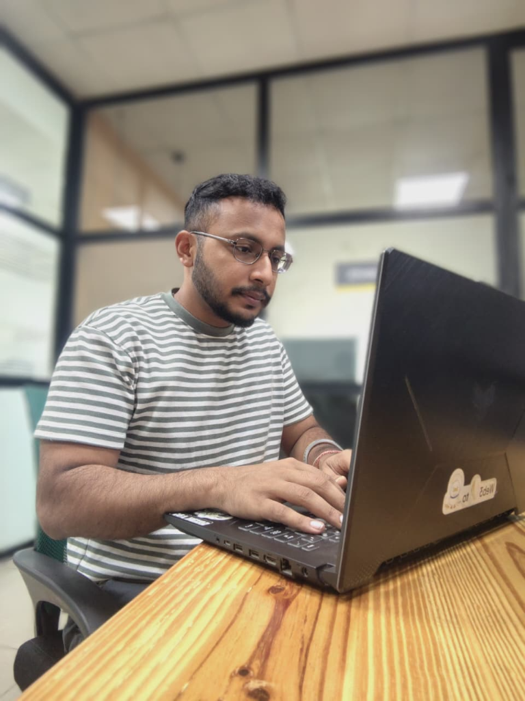

# Abhinav Kumar Singh — Modern 3D Developer Portfolio

A modern, responsive, 3D interactive developer portfolio designed and tailored for **Abhinav Kumar Singh** (Full Stack Developer Intern @ Easy Insights Pvt. Ltd.).



---

## ✨ Key Features & Design Highlights

1. **Interactive 3D Three.js Background**
   - High-performance, floating particle constellation and rotating geometric wireframe 3D meshes that gently respond to mouse cursor movement with smooth damping.
2. **3D Card Perspective & VanillaTilt**
   - Interactive 3D tilt effects on cards, including dynamic glare reflection when hovering over projects, stats, and awards.
3. **Typing Subtitle Animation**
   - Automated typewriter rotating across core specializations: *Full Stack Developer*, *Spring Boot & Java Architect*, *Django & Python Engineer*, *React & UI Specialist*.
4. **Interactive Terminal Window**
   - Real-world styled terminal (`abhinav@workspace: ~`) showing live JSON profile, strengths, and Git status.
5. **Interactive Skill Filtering**
   - Categorized tabs (`All Skills`, `Languages`, `Backend & Java`, `Web & React`, `Databases & Queues`, `Tools & CS`) allowing recruiters to instantly filter technologies.
6. **Production Experience Showcase**
   - Clean breakdown of ongoing internship at **Easy Insights Pvt. Ltd.** (Web Application Development & Task Processing & Monitoring System with RabbitMQ).
7. **Featured Projects (Ordered & Structured)**
   - **Task Processing & Monitoring System (Telegram Bot)**: Distributed RabbitMQ task queuing, bot notifications, worker health tracking & PostgreSQL persistence.
   - **Multi SpringAI Chat App**: Multi-model AI comparison engine (Java, Spring Boot, Spring AI, React Vite, Ollama, OpenAI, Anthropic).
   - **Aadhaar Management & Authentication System**: Relational citizen security APIs (Java 17, Spring Boot, Spring Data JPA, Hibernate, MySQL, Postman).
   - **PDF GENIE**: AI-Powered PDF Question Answering Tool (Python, Gemini API, Semantic Search across 200+ pages, 95% relevance).
   - **Employee Management System**: Full-Stack CRUD Web Application (Java, Servlets, JPA Hibernate, JSP, MySQL, Apache Tomcat).
8. **Resume & LaTeX Viewer Modal**
   - Interactive modal with instant toggle between an ATS-structured resume view, raw `.tex` LaTeX code viewer, one-click LaTeX clipboard copy, and native PDF print action.
9. **One-Click Contact & Clipboard Utilities**
   - Direct copy-to-clipboard buttons with toast notifications for Email and Phone, plus functional direct message form.

---

## 📁 Project Structure

```text
abhinav-portfolio/
├── index.html              # Main portfolio single-page application
├── resume.tex              # Original clean LaTeX resume source code
├── README.md               # Documentation & deployment guide
└── assets/
    ├── style.css           # Glassmorphism, animations, glow effects & custom CSS
    ├── script.js          # Three.js 3D canvas, tilt, typing, filters & modal handlers
    └── images/
        ├── working.png     # Candid workspace photo (Hero showcase)
        └── avatar.png      # Formal portrait photo (About showcase)
```

---

## 🚀 How to Run Locally

You can open `index.html` directly in any modern browser:

### Option A: Using Python (Recommended)
Open your terminal in this directory and start a local HTTP server:

```bash
cd /Users/mackbook/.gemini/antigravity/scratch/abhinav-portfolio
python3 -m http.server 8080
```
Then navigate to: **`http://localhost:8080`**

### Option B: Direct File Open
On macOS, simply run:
```bash
open index.html
```

---

## 🌐 Deploying to GitHub Pages / Vercel

### To GitHub Pages:
1. Create a GitHub repository (e.g., `portfolio` or `CodeMaestro-04.github.io`).
2. Push this folder to GitHub:
   ```bash
   git init
   git add .
   git commit -m "feat: initial commit of modern 3D portfolio"
   git branch -M main
   git remote add origin https://github.com/CodeMaestro-04/<repo-name>.git
   git push -u origin main
   ```
3. In your GitHub repository settings, go to **Pages**, select **Branch: main**, and click **Save**.
4. Your site will be live instantly!

---

## 📬 Contact & Profiles
- **Email:** [abhinavkrsingh83@gmail.com](mailto:abhinavkrsingh83@gmail.com)
- **Phone:** +91 6200529532
- **GitHub:** [github.com/CodeMaestro-04](https://github.com/CodeMaestro-04)
- **LinkedIn:** [linkedin.com/in/abhinav-kr-singh04](https://www.linkedin.com/in/abhinav-kr-singh04)
- **Portfolio:** https://abhinav-kr-singh.vercel.app/
